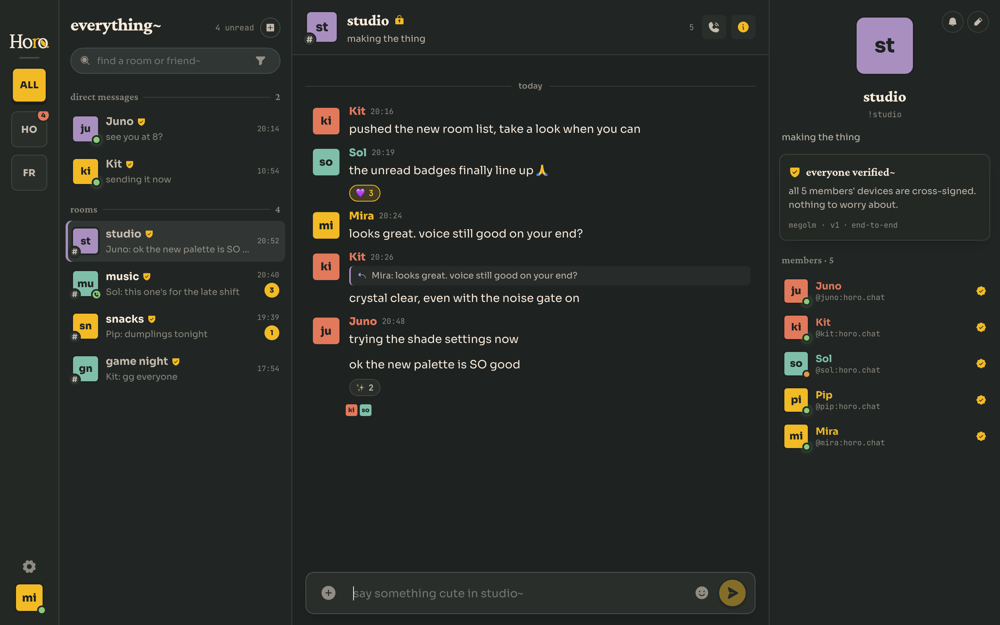

# horo
<p>
    <a href="https://github.com/gitautas/horo/releases/latest">
        </a>
    <a href="https://github.com/gitautas/horo/releases">
        </a>
</p>

A Matrix client for desktop and mobile, with end-to-end encryption and
LiveKit voice built in. Built with Tauri 2 and Rust on the backend and React on
the front.



## Getting started
Download the latest build for your platform from [GitHub releases]. Installed
apps on macOS, Windows and AppImage update themselves; other builds tell you
when a new version is out.

macOS and iOS are supported, Android runs on device, and Windows and Linux
build but are untested.

> [!NOTE]
> Voice calls don't work on Linux, because distribution builds of WebKitGTK
> ship without WebRTC.

[GitHub releases]: https://github.com/gitautas/horo/releases/latest

## Developing
```bash
npm install
npm run app            # desktop dev  (app:build for a release)
npm run ios            # iOS dev      (ios:build for an .ipa)
npm run android        # Android dev  (android:build -- --apk for an .apk)
```

Android needs an SDK, NDK and JDK; `npm run android` finds them if they are
installed.

Tagging `v*` builds every platform and publishes a signed release. The
repository needs `TAURI_SIGNING_PRIVATE_KEY` and
`TAURI_SIGNING_PRIVATE_KEY_PASSWORD` in its Actions secrets. Keep that key safe:
installed apps only accept updates signed with it.
