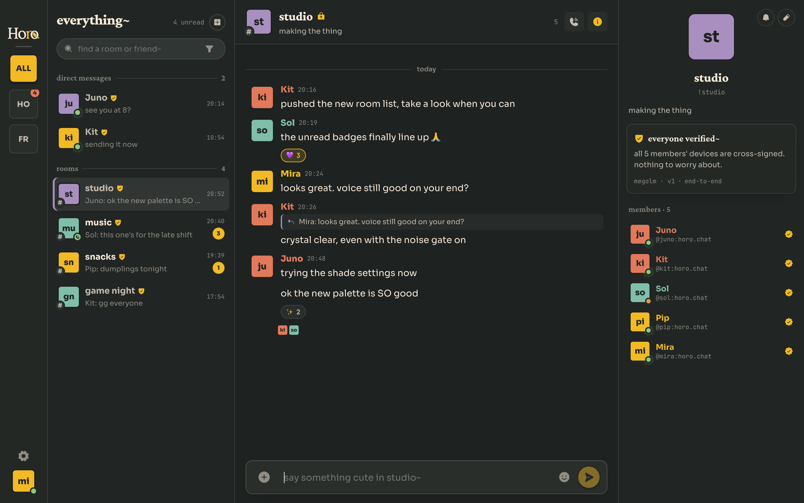

# horo

A fast, native Matrix desktop client with end-to-end encryption and built-in
LiveKit voice, video, and screen sharing—written in Rust with [GPUI].



## Highlights
- **Native calls (`horo-rtc`)**: Voice, camera, and screen sharing (720p/1080p, 30/60 fps) over MatrixRTC + LiveKit with echo cancellation, noise gate, speaking indicators, voice cues, resizable corner-snapping PiP, pop-out OS call window, and right-click per-user volume sliders (`0%–200%`).
- **Discord-style navigation**: Spaces with drag-reordering, custom roles & mentions, room/DM quick switcher (`⌘K` / `Ctrl+K`), unified Inbox drawer for unreads & mentions, pinned messages, threads, and per-room drafts.
- **Rich messaging**: End-to-end encryption & SAS verification, custom emote & sticker packs, voice messages, inline media lightbox & video thumbnails, copyable code blocks, message forwarding, slash commands (`/shrug`, `/tableflip`, `/unflip`, `/lenny`, `/me`, `/spoiler`), custom status, and private user notes.
- **Native & cross-platform**: macOS (Apple Silicon & Intel), Linux (AppImage & `.deb`, Wayland/X11 + PipeWire), and Windows, with signed self-updates.

## Getting started
Download the latest build for your platform from [GitHub releases]. Installed
apps on macOS, Windows, and Linux AppImage update themselves; `.deb` installs
notify you when a new version is out.

[GPUI]: https://www.gpui.rs/
[GitHub releases]: https://github.com/gitautas/horo/releases/latest

## Developing
```bash
git submodule update --init --depth 1 third_party/libvpx
scripts/desktop-dev.sh           # macOS dev .app bundle (isolated data dir)
cargo run -p horo-desktop        # Linux / Windows dev build
```

```bash
cargo test --workspace           # Rust unit tests; skips homeserver/livekit tests
scripts/test-homeserver/start.sh # a throwaway Synapse in Docker, then:
HORO_TEST_HOMESERVER=http://localhost:8008 cargo test -p horo-core --test homeserver
```

See [docs/releasing.md](docs/releasing.md) for packaging and release
instructions. Tagging `v*` builds every desktop platform and publishes a signed
release using `TAURI_SIGNING_PRIVATE_KEY` (and
`TAURI_SIGNING_PRIVATE_KEY_PASSWORD`) in GitHub Actions secrets.

## License
Licensed under the [GNU Affero General Public License v3.0 or later](LICENSE) (`AGPL-3.0-or-later`).
